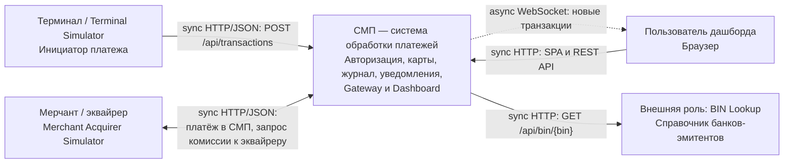

# А1. C4 Context — границы СМП

В [существующей архитектуре](../../architecture.md) не было отдельной схемы границ. Добавлены внешние роли, протоколы и пояснение, чем логическая граница отличается от запуска в Compose.

Сплошная стрелка — синхронный HTTP-запрос с ответом; пунктир — асинхронный WebSocket push. На этом уровне RabbitMQ скрыт внутри СМП; его связи раскрыты в [А2](02-containers.md) и [А5](05-rabbitmq.md). HTTP указан по конфигурации локального стенда; TLS здесь не предполагается.

Терминал, эквайрер и BIN Lookup находятся снаружи **логической границы платёжного ядра**. В локальном стенде их эмуляторы запускаются в том же Compose, что и СМП. Пользователь работает с Dashboard, который входит в систему; браузер пользователя находится снаружи. Внешняя роль BIN Lookup реализована локальным сервисом со статической таблицей, а не соединением с реальным банком.

| Связь / роль | Подтверждение в репозитории |
|---|---|
| Терминал отправляет платежи | [GatewayClient терминала](../../../services/terminal-simulator/src/main/java/com/processing/terminalsimulator/client/GatewayClient.java) |
| Эквайрер отправляет платежи | [GatewayClient эквайрера](../../../services/merchant-acquirer/src/main/java/com/processing/merchantacquirer/client/GatewayClient.java) |
| СМП запрашивает комиссию у эквайрера | [MerchantAcquirerClient.fetchAcquiringFee](../../../services/switch/src/main/java/com/processing/service/MerchantAcquirerClient.java) |
| Браузер: REST через Gateway, WebSocket через Logger | [nginx.conf](../../../services/dashboard/nginx.conf), [useWebSocket.ts](../../../services/dashboard/src/hooks/useWebSocket.ts) |
| Authorization обращается к BIN Lookup | [BinLookupClient.getIssuerId](../../../services/authorization/src/main/java/com/processing/authorization/client/BinLookupClient.java), [BinLookupController](../../../services/bin-lookup/src/main/java/com/processing/binlookup/controller/BinLookupController.java) |
| Совместное развёртывание ядра и эмуляторов | [docker-compose.yaml](../../../docker-compose.yaml) |

Для тестирования эта граница задаёт область: E2E запускает платёж через вход Gateway, а внешний справочник можно заменить управляемым HTTP-стендом. Проверка настоящих банков и платёжных сетей в область работы не входит.
