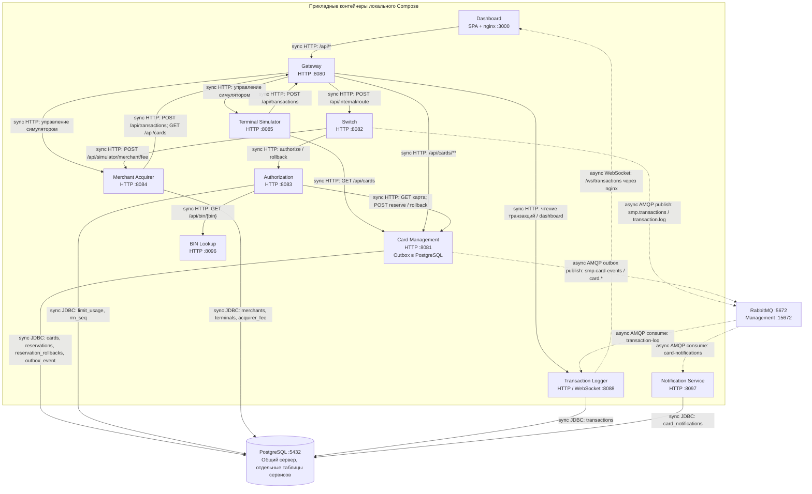

# А2. C4 Container — сервисы и способы связи

В [исходной схеме](../../architecture.md) связи не были последовательно разделены на sync/async, а сведения о publisher confirms требуют проверки по реализации. Добавлены типы связей, две ветви AMQP, пять владельцев данных и сверка состава с [Compose](../../../docker-compose.yaml).

Сплошная линия — sync HTTP/JDBC; пунктир с меткой AMQP — async очередь; пунктир WebSocket — push в браузер. Стрелка AMQP не обещает немедленную обработку потребителем. Порты — стандартные **host-порты** из окружения проекта; внутри сети контейнеров приложения слушают `8080`, Dashboard — `3000`. Порты могут быть переопределены через `.env`.

Схема показывает платёжные, карточные и пользовательские связи. Health-check, раздача OpenAPI и сбор метрик опущены, чтобы они не скрывали путь денег.

| Проверяемая часть | Источники |
|---|---|
| Состав, внутренние порты, переменные окружения | [docker-compose.yaml](../../../docker-compose.yaml), [.env.example](../../../.env.example) |
| Gateway: маршруты и rewrite | [application.yml](../../../services/gateway/src/main/resources/application.yml) |
| Платежи обоих симуляторов идут в Gateway; терминал читает карты напрямую через HTTP CMS, эквайрер — через Gateway | [клиент терминала](../../../services/terminal-simulator/src/main/java/com/processing/terminalsimulator/client/GatewayClient.java), [клиент эквайрера](../../../services/merchant-acquirer/src/main/java/com/processing/merchantacquirer/client/GatewayClient.java) |
| Dashboard: REST и WebSocket имеют разные upstream | [nginx.conf](../../../services/dashboard/nginx.conf) |
| Switch: Authorization, комиссия и публикация | [RouteService](../../../services/switch/src/main/java/com/processing/service/RouteService.java), [AuthorizationClient](../../../services/switch/src/main/java/com/processing/service/AuthorizationClient.java), [MerchantAcquirerClient](../../../services/switch/src/main/java/com/processing/service/MerchantAcquirerClient.java), [LoggerClient](../../../services/switch/src/main/java/com/processing/service/LoggerClient.java) |
| Authorization: CMS, BIN, использование лимитов | [AuthServiceImpl](../../../services/authorization/src/main/java/com/processing/authorization/services/AuthServiceImpl.java), [CardManagementClientImpl](../../../services/authorization/src/main/java/com/processing/authorization/client/CardManagementClientImpl.java), [LimitUsageRepository](../../../services/authorization/src/main/java/com/processing/authorization/repositories/LimitUsageRepository.java) |
| CMS: транзакции и outbox | [CardServiceImpl](../../../services/card-management/src/main/java/com/processing/cardmanagement/services/CardServiceImpl.java), [CardEventNotifierImpl](../../../services/card-management/src/main/java/com/processing/cardmanagement/events/CardEventNotifierImpl.java), [OutboxProcessor](../../../services/card-management/src/main/java/com/processing/cardmanagement/services/OutboxProcessor.java), [миграции](../../../services/card-management/src/main/resources/db/migration) |
| RabbitMQ exchange / queue / binding | [Switch RabbitMQConfig](../../../services/switch/src/main/java/com/processing/config/RabbitMQConfig.java), [CMS RabbitMQConfig](../../../services/card-management/src/main/java/com/processing/cardmanagement/config/RabbitMQConfig.java) |
| Потребители и сохранение данных | [TransactionLogListener](../../../services/transaction-logger/src/main/java/com/processing/transactionlogger/listener/TransactionLogListener.java), [TransactionService](../../../services/transaction-logger/src/main/java/com/processing/transactionlogger/service/TransactionService.java), [CardEventListener](../../../services/notification-service/src/main/java/com/processing/notification/listener/CardEventListener.java), [миграции эквайрера](../../../services/merchant-acquirer/src/main/resources/db/migration) |

## Расхождения с описанием задания

В основном Compose **10 прикладных сервисов + PostgreSQL + RabbitMQ**. Число «11 сервисов» в документации не соответствует базовому запуску этого среза. Профиль `observability` добавляет `autoscaler`, Prometheus, Grafana, Loki, Promtail — ещё пять контейнеров. Autoscaler нельзя незаметно выдавать за одиннадцатый сервис платёжного ядра: он запускается только с профилем.

`publisher-confirm-type: correlated` настроен, но [LoggerClient.log](../../../services/switch/src/main/java/com/processing/service/LoggerClient.java) возвращает успех после `convertAndSend` и не ждёт ACK за 2 секунды. Аналогично outbox помечается `PROCESSED` после отправки без ожидания ACK. Поэтому требование подтверждённой доставки отмечено как пробел, а не как реализованная связь. Детали — в [А5](05-rabbitmq.md).
