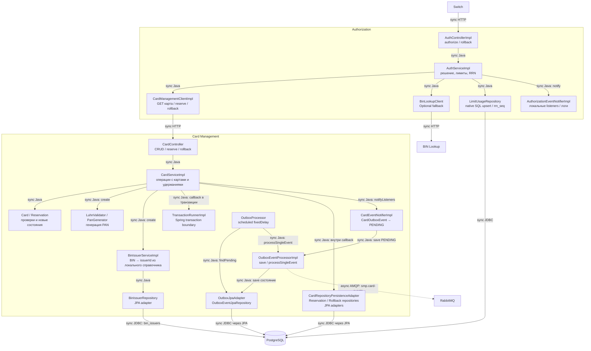

# А3. C4 Component — Authorization и Card Management

В [исходной архитектуре](../../architecture.md) отсутствовал компонентный уровень. Добавлены классы контроллеров, бизнес-логики, HTTP-клиентов, репозиториев и outbox. Внутрипроцессные вызовы помечены `Java`; HTTP/JDBC — синхронные внешние вызовы, AMQP — асинхронная доставка.

Граница unit-теста проходит вокруг класса или небольшой группы доменных объектов. Подстановка репозитория проверяет решение и вызовы; она не доказывает работу SQL, блокировок или атомарность транзакции. Эти свойства требуют настоящего PostgreSQL. Доставка события требует RabbitMQ и потребителя.

| Компоненты / связь | Подтверждение в коде |
|---|---|
| Auth controller → service | [AuthControllerImpl](../../../services/authorization/src/main/java/com/processing/authorization/controller/AuthControllerImpl.java) |
| Порядок проверок, reserve, rollback, локальные события | [AuthServiceImpl](../../../services/authorization/src/main/java/com/processing/authorization/services/AuthServiceImpl.java), [AuthorizationEventNotifierImpl](../../../services/authorization/src/main/java/com/processing/authorization/events/AuthorizationEventNotifierImpl.java) |
| HTTP CMS / BIN | [CardManagementClientImpl](../../../services/authorization/src/main/java/com/processing/authorization/client/CardManagementClientImpl.java), [BinLookupClient](../../../services/authorization/src/main/java/com/processing/authorization/client/BinLookupClient.java) |
| PostgreSQL: лимиты и RRN | [LimitUsageRepository](../../../services/authorization/src/main/java/com/processing/authorization/repositories/LimitUsageRepository.java) |
| CMS controller → service → transaction / domain / repository | [CardController](../../../services/card-management/src/main/java/com/processing/cardmanagement/controllers/CardController.java), [CardServiceImpl](../../../services/card-management/src/main/java/com/processing/cardmanagement/services/CardServiceImpl.java), [TransactionRunnerImpl](../../../services/card-management/src/main/java/com/processing/cardmanagement/services/TransactionRunnerImpl.java), [Card](../../../services/card-management/src/main/java/com/processing/cardmanagement/models/Card.java), [Reservation](../../../services/card-management/src/main/java/com/processing/cardmanagement/models/Reservation.java), [repositories](../../../services/card-management/src/main/java/com/processing/cardmanagement/repositories) |
| Создание карты: PAN и локальный справочник BIN | [LuhnValidator](../../../services/card-management/src/main/java/com/processing/cardmanagement/services/LuhnValidator.java), [BinIssuerServiceImpl](../../../services/card-management/src/main/java/com/processing/cardmanagement/services/BinIssuerServiceImpl.java), [BinIssuerRepository](../../../services/card-management/src/main/java/com/processing/cardmanagement/repositories/BinIssuerRepository.java) |
| Сохранение outbox и последующая публикация | [CardEventNotifierImpl](../../../services/card-management/src/main/java/com/processing/cardmanagement/events/CardEventNotifierImpl.java), [OutboxEventProcessorImpl](../../../services/card-management/src/main/java/com/processing/cardmanagement/services/OutboxEventProcessorImpl.java), [OutboxProcessor](../../../services/card-management/src/main/java/com/processing/cardmanagement/services/OutboxProcessor.java), [OutboxJpaAdapter](../../../services/card-management/src/main/java/com/processing/cardmanagement/repositories/OutboxJpaAdapter.java) |
| Интервал и число попыток | [application.properties](../../../services/card-management/src/main/resources/application.properties): `app.outbox.interval-ms=1000`, `max-retry-count=3` по умолчанию |

## Что важно не перепутать

Authorization получает карту **до** обращения к BIN Lookup; результат BIN Lookup сейчас только логируется, а `issuerId` запроса задаёт Switch. После статуса и срока проверяется баланс, затем SQL лимитов — это расходится с порядком из [ТЗ Authorization, п. 2](../../../tz/04-authorization.md) и [BUG-P2-002](../../practice-2/test-design.md#bug-p2-002).

`@Transactional` Authorization не создаёт общей транзакции с удалённым CMS. Пойманная ошибка reserve с возвратом `DECLINED` не гарантирует откат ранее обновлённых лимитов. `rollback()` вызывает CMS, но не уменьшает `limit_usage`. Это риски частичной согласованности между сервисами.

CMS сохраняет изменение и outbox в локальной транзакции для patch/delete/reserve/rollback. Создание одиночной карты в `createCard()` не обёрнуто `TransactionRunner`, а событие сохраняется после `cardRepository.create()`; общая атомарность create + outbox из этого метода не следует. Публикация scheduled-процессором происходит позже, вне транзакции первоначальной операции. `PROCESSED` означает возврат из отправки, а не обработку уведомления подписчиком. Экспоненциальный backoff из [ТЗ CMS](../../../tz/05-card-management.md) в `OutboxProcessor` не реализован: используется фиксированный интервал.
