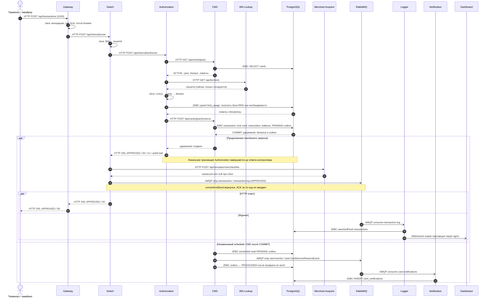
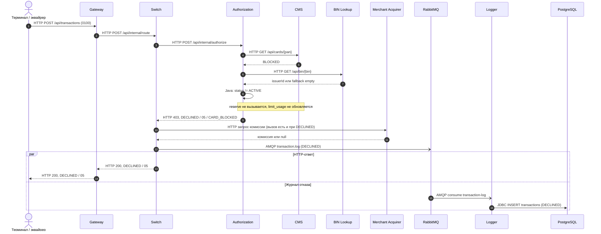
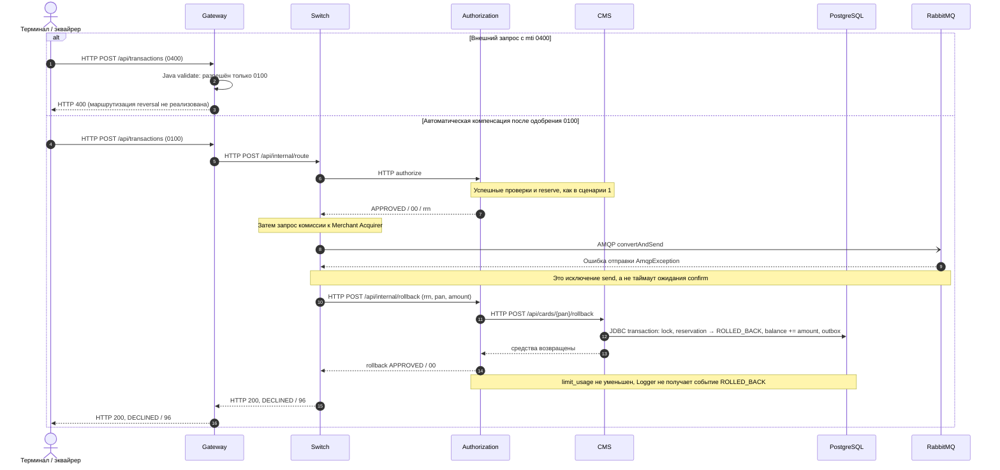
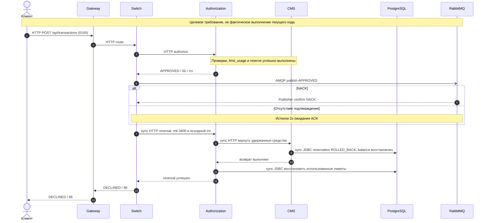

# А4. Sequence — одобрение, отказ, компенсация

В [исходной архитектуре](../../architecture.md) есть только happy path. Добавлены отказ `BLOCKED` и компенсация, уточнён фактический порядок CMS → BIN → баланс → лимиты, показаны две асинхронные ветви. Сценарии ниже отражают текущий код. Требования MTI `0400` и ожидания publisher confirm отдельно сопоставлены с реализацией.

Легенда: `->>` — sync HTTP/JDBC или явно подписанный локальный вызов; `-->>` — ответ; `-)` — async AMQP/WebSocket. Запись в Logger и уведомления могут появиться как до HTTP-ответа клиенту, так и после него; строгого порядка между этими ветвями нет.

## 1. Happy path: карта ACTIVE, достаточно средств и лимитов

Scheduler CMS независим от платёжного запроса: после COMMIT он может прочитать событие уже на ближайшем запуске, даже до ответа CMS в Authorization. Он не ждёт расчёта комиссии или публикации Switch. Outbox хранит события отдельно от брокера. `PROCESSED` не доказывает, что Notification уже сохранил запись; HTTP `APPROVED` не доказывает, что Logger уже обработал очередь. Проверка eventual consistency должна опрашивать состояние по корреляционным полям с конечным сроком ожидания.

## 2. Declined: карта BLOCKED

Бизнес-проверки Authorization заканчиваются отказом, но Switch продолжает запрос комиссии и публикацию журнала. HTTP `403` внутреннего Authorization преобразуется в HTTP `200` контроллером Switch; бизнес-код `05` остаётся в JSON. Поэтому HTTP-код и `responseCode` нельзя считать одним полем.

## 3. Reversal: требуемый MTI 0400 и фактическая компенсация

По [ТЗ Switch, п. 3–4](../../../tz/03-switch.md), NACK или отсутствие confirm за 2 секунды должны инициировать reversal, а [ТЗ Authorization, дополнительные задания](../../../tz/04-authorization.md) требует восстановления лимитов. Сейчас механизм частичный:

- `LoggerClient` не ждёт confirm. Если `convertAndSend` завершится без исключения, последующий NACK / отсутствие ACK не вызовет rollback.
- Switch создаёт `RollbackRequest` и вызывает отдельный `/api/internal/rollback`; это не HTTP-маршрутизация ISO-запроса с `mti=0400`.
- Authorization возвращает средства через CMS, но не восстанавливает использованные лимиты и не обновляет журнал транзакции.
- Switch возвращает код `96` даже при неуспешном ответе rollback; сам `96` не подтверждает возврат денег.

Это основания для требовательных тестов отказа, а не повод заменить ожидаемый результат текущей ошибкой. Чтобы требование `0400` было видно как полный путь, ниже приведена **целевая схема** третьего сценария. Её отличия от предыдущей схемы сейчас не реализованы.

URL и JSON-контракт целевого `0400` здесь намеренно не выдуманы: ТЗ задаёт механизм, текущий код использует иной DTO / endpoint. При реализации понадобится согласовать контракт и обработку повторного reversal.

| Шаги схем | Источник |
|---|---|
| Валидация MTI, маршруты и порядок фильтров Gateway | [TransactionRequestValidator](../../../services/gateway/src/main/java/com/processing/gateway/validation/TransactionRequestValidator.java), [TransactionValidationFilter](../../../services/gateway/src/main/java/com/processing/gateway/validation/TransactionValidationFilter.java), [application.yml](../../../services/gateway/src/main/resources/application.yml), [фильтры Gateway](../../../services/gateway/src/main/java/com/processing/gateway) |
| BIN, вызовы authorize / fee / logger / rollback | [RoutingService](../../../services/switch/src/main/java/com/processing/service/RoutingService.java), [RouteService](../../../services/switch/src/main/java/com/processing/service/RouteService.java), [AuthorizationClient](../../../services/switch/src/main/java/com/processing/service/AuthorizationClient.java), [LoggerClient](../../../services/switch/src/main/java/com/processing/service/LoggerClient.java) |
| HTTP 200 Switch и HTTP 403 Authorization | [RouteController](../../../services/switch/src/main/java/com/processing/controller/RouteController.java), [AuthControllerImpl](../../../services/authorization/src/main/java/com/processing/authorization/controller/AuthControllerImpl.java) |
| Порядок авторизации и отсутствие уменьшения лимитов в rollback | [AuthServiceImpl](../../../services/authorization/src/main/java/com/processing/authorization/services/AuthServiceImpl.java) |
| Удержание, возврат и outbox CMS | [CardServiceImpl](../../../services/card-management/src/main/java/com/processing/cardmanagement/services/CardServiceImpl.java), [OutboxEventProcessorImpl](../../../services/card-management/src/main/java/com/processing/cardmanagement/services/OutboxEventProcessorImpl.java) |
| Обработка очередей, JDBC и WebSocket | [TransactionLogListener](../../../services/transaction-logger/src/main/java/com/processing/transactionlogger/listener/TransactionLogListener.java), [TransactionService](../../../services/transaction-logger/src/main/java/com/processing/transactionlogger/service/TransactionService.java), [CardEventListener](../../../services/notification-service/src/main/java/com/processing/notification/listener/CardEventListener.java) |
