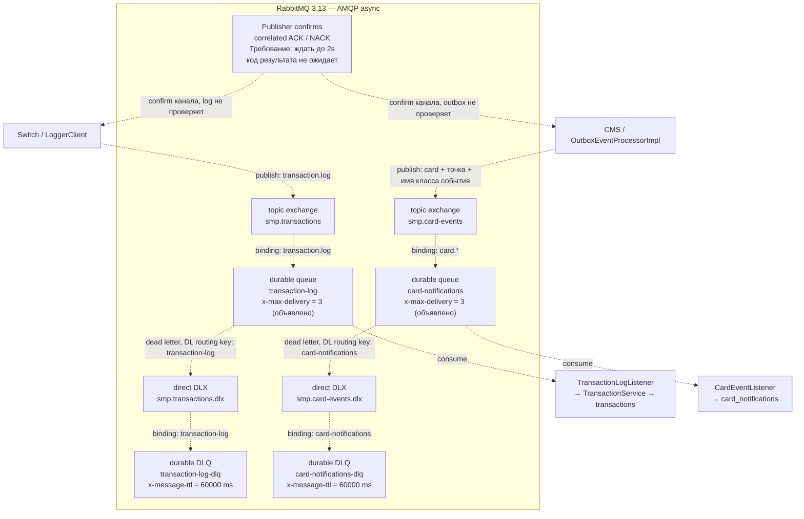

# А5. RabbitMQ — публикация, доставка, dead letters

В [исходной архитектуре](../../architecture.md) топология изложена преимущественно текстом и таблицей. Добавлена схема двух независимых потоков с exchange, routing key, queue, consumer, DLX и DLQ. Отдельно указано, какие параметры только объявлены и какое подтверждение код реально обрабатывает.

Все стрелки схемы — async AMQP. Durable — сохранение определения exchange/queue после перезапуска брокера; это само по себе не доказывает успешную публикацию или выполнение операции потребителем. DLQ не имеет прикладного listener в данном срезе; сообщения предназначены для диагностики и истекают.

| Свойство | Что объявлено / реализовано | Что нужно проверить |
|---|---|---|
| Publisher confirms | Switch и CMS: `publisher-confirm-type=correlated` | Нет ожидания результата confirm в `LoggerClient.log` и `processSingleEvent`; требование NACK / timeout **2s** из ТЗ Switch не обеспечено |
| Возврат не маршрутизированного сообщения | Switch: `publisher-returns=true` | Метод `log` не проверяет returns; успех отправки не доказывает попадание в очередь |
| Retry потребителей | Обе основные очереди имеют аргумент `x-max-delivery=3` | В коде listeners нет счётчика трёх попыток; тип quorum и политика delivery limit не заданы. Аргумент с таким именем нельзя считать доказательством трёх доставок и ухода в DLQ |
| Retry outbox | `max-retry-count=3`; исключение отправки увеличивает `retryCount`, третья ошибка → `FAILED` | Это три попытки **публикации outbox**, а не три доставки consumer. Fixed delay по умолчанию 1000 ms; exponential backoff отсутствует |
| TTL | Обе **DLQ** имеют `x-message-ttl=60000` ms | Основные очереди этим TTL не ограничены. После истечения диагностическая запись исчезает из DLQ; автоматический возврат в основную очередь не задан |
| Dead letter | Основные очереди ссылаются на свой DLX и DL routing key | Проверять реальный reject/nack с `requeue=false` и попадание в DLQ. Исключение listener само по себе не доказывает конкретную политику requeue |
| Идемпотентность Logger | `TransactionService.store`: одинаковый `id` и содержимое → существующая запись без повторного WebSocket broadcast | Проверка повторной доставки должна сохранять тот же UUID сообщения, а не только STAN; новый UUID считается отдельной транзакцией |
| Notification | Валидирует JSON, извлекает тип из routing key, сохраняет уведомление | В listener нет дедупликации по ID исходного события; нельзя обещать exactly-once для уведомлений |

## Источники топологии и поведения

- Транзакционный поток: [Switch RabbitMQConfig](../../../services/switch/src/main/java/com/processing/config/RabbitMQConfig.java), [Logger RabbitMQConfig](../../../services/transaction-logger/src/main/java/com/processing/transactionlogger/config/RabbitMQConfig.java), [LoggerClient](../../../services/switch/src/main/java/com/processing/service/LoggerClient.java), [TransactionLogListener](../../../services/transaction-logger/src/main/java/com/processing/transactionlogger/listener/TransactionLogListener.java), [TransactionService](../../../services/transaction-logger/src/main/java/com/processing/transactionlogger/service/TransactionService.java).
- Карточный поток: [CMS RabbitMQConfig](../../../services/card-management/src/main/java/com/processing/cardmanagement/config/RabbitMQConfig.java), [Notification RabbitMQConfig](../../../services/notification-service/src/main/java/com/processing/notification/config/RabbitMQConfig.java), [OutboxEventProcessorImpl](../../../services/card-management/src/main/java/com/processing/cardmanagement/services/OutboxEventProcessorImpl.java), [OutboxProcessor](../../../services/card-management/src/main/java/com/processing/cardmanagement/services/OutboxProcessor.java), [CardEventListener](../../../services/notification-service/src/main/java/com/processing/notification/listener/CardEventListener.java).
- Параметры: [Switch application.yml](../../../services/switch/src/main/resources/application.yml), [CMS application.properties](../../../services/card-management/src/main/resources/application.properties), [Compose — образ брокера](../../../docker-compose.yaml).
- Требуемые confirm / reversal: [ТЗ Switch, п. 3–4](../../../tz/03-switch.md); outbox retry: [ТЗ CMS, «Асинхронная публикация событий»](../../../tz/05-card-management.md).

Eventual consistency проверяется по факту сохранения коррелируемого сообщения: ожидать нужную запись до ограниченного deadline, повторяя чтение. Один фиксированный `sleep` не доказывает ни доставку, ни отсутствие дубликатов. Publisher confirm относится к приёму брокером и не заменяет проверку потребителя и его БД.
