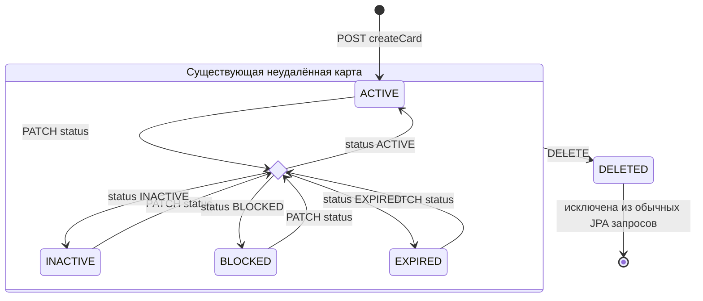
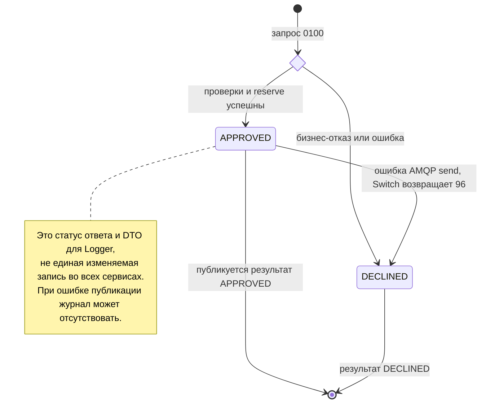
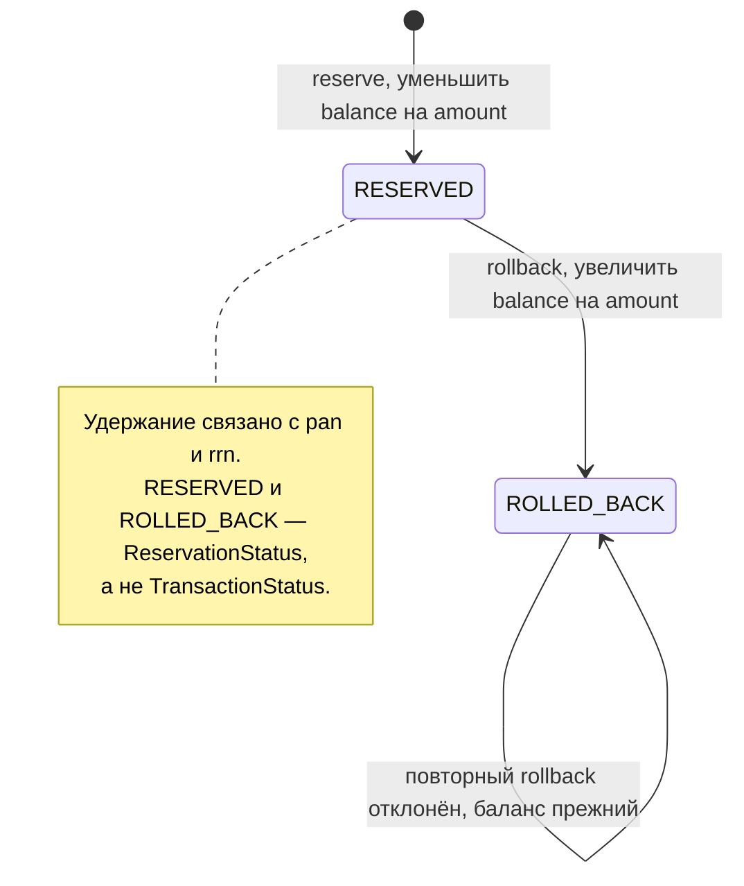
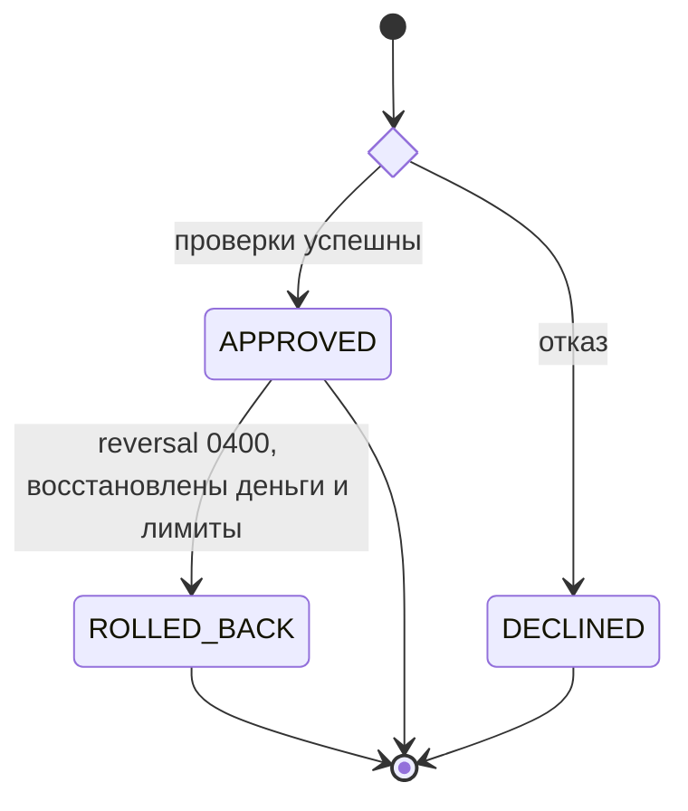
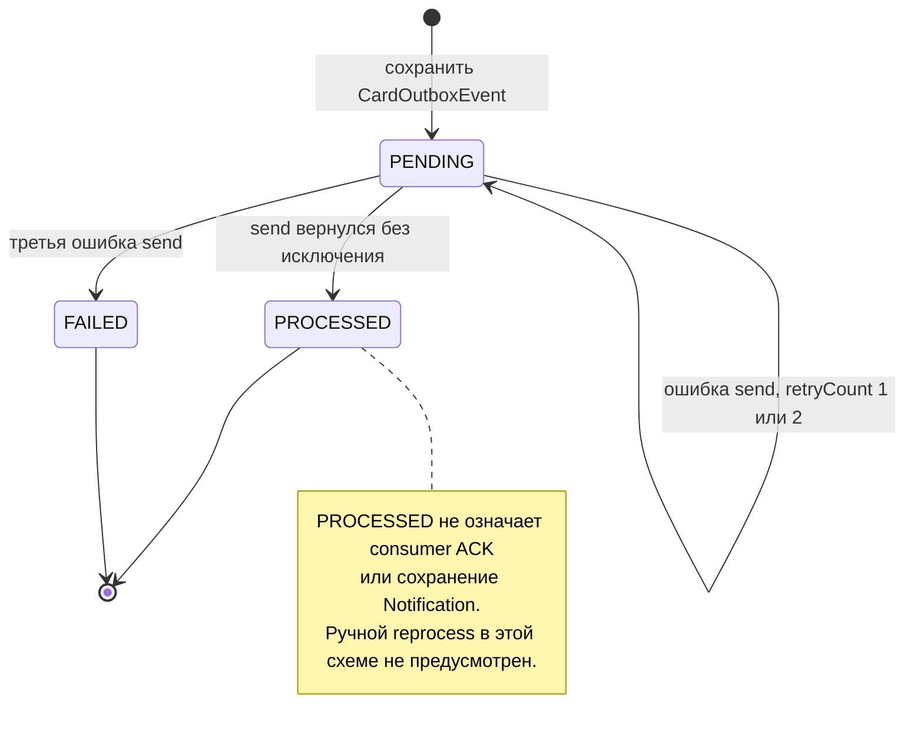

# А6. State transition — карта, операция и удержание

В [исходной архитектуре](../../architecture.md) отсутствовали диаграммы состояний. Добавлены состояния карты, фактический результат транзакции, компенсация удержания и состояния outbox. Желаемый переход транзакции в `ROLLED_BACK` показан отдельно от перечислений, существующих в коде.

## Card.status

`PATCH` здесь — узел выбора, **не значение enum**. Через HTTP можно менять статус неудалённой карты между четырьмя значениями `CardModelStatus`; нельзя придумывать запрет `BLOCKED → ACTIVE`. `DELETED` есть во внутреннем `CardStatus`, но отсутствует в DTO PATCH: этот переход запускается DELETE. После мягкого удаления строка остаётся в БД, но `@SQLRestriction` исключает её из обычного поиска. Генератор может создавать карты и в других статусах; вход `POST createCard → ACTIVE` относится именно к одиночному созданию.

Проверка истёкшего срока при authorize не меняет `Card.status` автоматически. Reserve / rollback меняют баланс, сохраняя статус карты.

## Transaction — фактические состояния результата

В [TransactionStatus](../../../services/common/src/main/java/com/processing/common/dto/transactionlogger/TransactionStatus.java) есть только `APPROVED` и `DECLINED`. Стрелка `APPROVED → DECLINED` показывает изменение **окончательного ответа Switch** после одобрения Authorization, а не SQL-update уже сохранённой строки Logger. Switch не публикует исправленный результат после неудачной отправки и rollback.

## Reservation — фактическая компенсация

## Требуемый бизнес-жизненный цикл транзакции

Эта последняя схема задаёт **целевую бизнес-модель из задания / ТЗ**, а не реализованный enum. В коде частично есть возврат денег через отдельный rollback endpoint, но нет состояния транзакции `ROLLED_BACK`, маршрутизации `0400` через Gateway и уменьшения `limit_usage`. Эти пробелы не скрыты под «успешный rollback».

## Outbox — состояние публикации

Способы взаимодействия при переходах: HTTP sync запускает CRUD/reserve/rollback; JDBC sync сохраняет состояния; scheduled publisher и потребители связаны async AMQP. Enum сам по себе задаёт только множество состояний; разрешённые переходы устанавливает код операций.

| Состояния / переходы | Подтверждение |
|---|---|
| Карта, patch, reserve, rollback, delete | [CardStatus](../../../services/card-management/src/main/java/com/processing/cardmanagement/models/CardStatus.java), [CardModelStatus — публичные статусы](../../../services/common/src/main/java/com/processing/common/dto/cardmanagement/CardModelStatus.java), [Card.withData / deleted / withReservation / withRollback](../../../services/card-management/src/main/java/com/processing/cardmanagement/models/Card.java), [CardServiceImpl](../../../services/card-management/src/main/java/com/processing/cardmanagement/services/CardServiceImpl.java), [CardEntity — SQLRestriction](../../../services/card-management/src/main/java/com/processing/cardmanagement/models/CardEntity.java) |
| Решение авторизации, срок и код отказа | [AuthServiceImpl](../../../services/authorization/src/main/java/com/processing/authorization/services/AuthServiceImpl.java), [DeclineOutcome](../../../services/authorization/src/main/java/com/processing/authorization/constants/DeclineOutcome.java) |
| Итог Switch при ошибке публикации | [RouteService.route](../../../services/switch/src/main/java/com/processing/service/RouteService.java) |
| Удержание и запрет повторного возврата | [ReservationStatus](../../../services/card-management/src/main/java/com/processing/cardmanagement/models/ReservationStatus.java), [Reservation.startRollback / rolledBack](../../../services/card-management/src/main/java/com/processing/cardmanagement/models/Reservation.java) |
| Состояния outbox и попытки | [OutboxEventDataStatus](../../../services/card-management/src/main/java/com/processing/cardmanagement/models/OutboxEventDataStatus.java), [CardOutboxEventData](../../../services/card-management/src/main/java/com/processing/cardmanagement/models/CardOutboxEventData.java), [OutboxEventProcessorImpl](../../../services/card-management/src/main/java/com/processing/cardmanagement/services/OutboxEventProcessorImpl.java) |
| Целевой reversal и восстановление лимитов | [ТЗ Switch, п. 3–4](../../../tz/03-switch.md), [ТЗ Authorization, дополнительные задания](../../../tz/04-authorization.md) |

По этой карте выбираются проверки: доменные переходы и отсутствие повторного возврата — unit; сохранение перехода в БД — integration; блокировка карты и последующий платёж через всю цепочку — E2E. Покрытие только enum без вызова операции не проверяет переход.
